# RedHawk Pharmacy: Architecture

This document turns the Detailed Design Specification (DDS v0.1) into diagrams, applied to the chosen stack: **TypeScript · React · Express · SQLite**. Every diagram is Mermaid, which GitHub renders inline.

Module IDs (M01–M16), requirement IDs (F1–F25) and test IDs (T01–T66) match the SRS, DDS and Test Plan.

**Contents**

1. [System context](#1-system-context)
2. [Containers and deployment](#2-containers-and-deployment)
3. [Layered architecture and dependency rules](#3-layered-architecture-and-dependency-rules)
4. [Module map (M01–M16)](#4-module-map-m01m16)
5. [Data model](#5-data-model)
6. [Key workflows](#6-key-workflows)
7. [State machines](#7-state-machines)
8. [API surface](#api-surface)
9. [Security and privacy boundaries](#9-security-and-privacy-boundaries)
10. [Integration increments](#10-integration-increments)

---

## 1. System context

Who uses the system and which external systems it talks to. Every external system sits behind an adapter and can be replaced by a stub in tests.

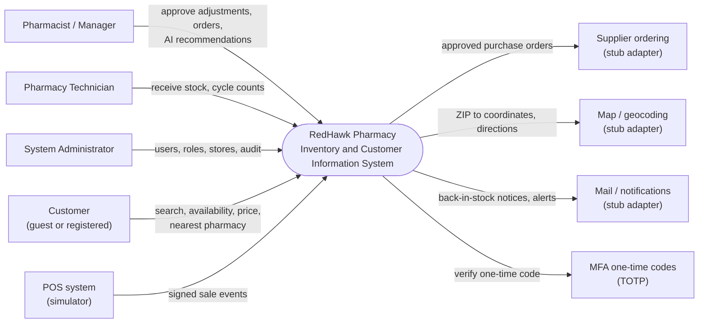

## 2. Containers and deployment

The semester prototype runs one backend process, one SQLite file and one worker (DDS §3.3). The React app is a single bundle with two route trees: staff and public.

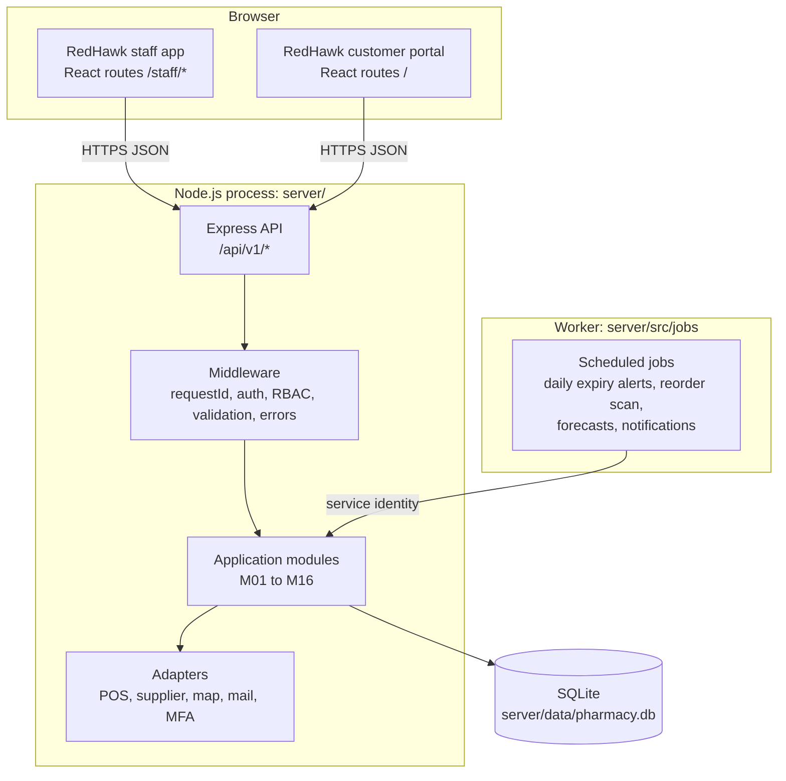

> **Why SQLite?** `better-sqlite3` gives synchronous, serializable transactions. That lets M04 check availability, post the issue and audit in one `db.transaction(...)` without any race, which covers T04 and T16. SQLite's single-writer model is fine at prototype scale. The repository layer keeps SQL in one place, so a later move to Postgres touches only that layer.

## 3. Layered architecture and dependency rules

Requests flow downward only. The UI never touches the database. Only the Stock Ledger writes stock quantities.

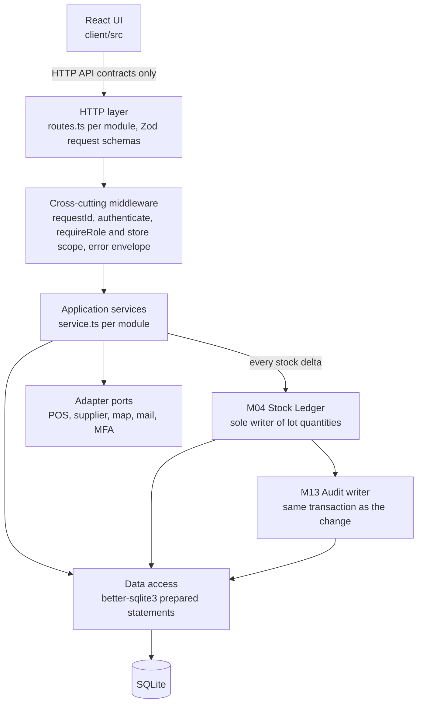

| Caller | May depend on | Must never |
|---|---|---|
| Staff UI / Customer UI | `/api/v1` HTTP contracts | Read the database or internal types beyond `shared/` |
| Inventory, Ordering, Expiration (M03, M05, M06, M07) | Catalog, stores, repository, auth context, audit, **M04 for any stock change** | Bypass document posting and audit |
| Public Search (M10, M11) | Public product projection, availability classifier, store lookup | Return quantities or Schedule II availability |
| Forecasting (M09) | Read-only sales history and inventory snapshots | Write stock or purchase orders |
| AI chat (M16) | Read-only forecast/recommendation queries | Mutate anything; proposals become review requests |
| Adapters | Published ports only | Write stock directly |
| Jobs | Application-service commands under a service identity | Bypass audit |

## 4. Module map (M01–M16)

Arrows read "depends on". Colors mark the DDS build packages: kernel K0, operational K1, analytics K2, extensions E1/E2.

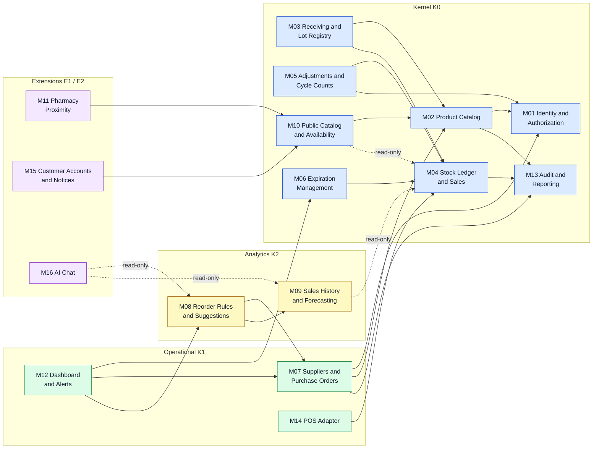

Each module lives in `server/src/modules/mNN-<name>/` and has the same shape:

| File | Contents |
|---|---|
| `service.ts` | Exported functions and classes with the DDS signatures, e.g. `applySale(storeId, productId, qty, eventId)` |
| `routes.ts` | Express router for the module's `/api/v1` endpoints, with Zod request schemas |
| `*.test.ts` (in `server/tests/`) | Unit and integration tests named after Test Plan IDs |
| `drivers/mNN.driver.ts` | DDS §10 module driver: calls exports with mocked imports and prints a structured result |

## 5. Data model

This model implements DDS §5 directly. Money is stored as integer cents and timestamps as ISO-8601 UTC strings. `expires_on` is a store-local calendar date (`YYYY-MM-DD`).

```mermaid
erDiagram
    STORE ||--o{ STORE_PRODUCT : lists
    PRODUCT ||--o{ STORE_PRODUCT : "is listed as"
    STORE_PRODUCT ||--o{ LOT : "stocked in"
    SUPPLIER ||--o{ LOT : supplies
    LOT ||--o{ DOCUMENT_LINE : "received or issued"
    DOCUMENT ||--|{ DOCUMENT_LINE : contains
    LOT ||--o{ ADJUSTMENT_REQUEST : "corrected by"
    STORE ||--o{ PURCHASE_ORDER : places
    SUPPLIER ||--o{ PURCHASE_ORDER : receives
    PURCHASE_ORDER ||--|{ PURCHASE_ORDER_LINE : contains
    PRODUCT ||--o{ PURCHASE_ORDER_LINE : "ordered as"
    SUPPLIER ||--o{ SUPPLIER_PRODUCT : prices
    PRODUCT ||--o{ SUPPLIER_PRODUCT : "priced by"
    STORE ||--o{ SALES_EVENT : records
    PRODUCT ||--o{ SALES_EVENT : "sold as"
    STORE_PRODUCT ||--o{ FORECAST : "forecast for"
    STORE_PRODUCT ||--o{ RECOMMENDATION : "advised for"
    USER ||--o{ ROLE_ASSIGNMENT : holds
    STORE ||--o{ ROLE_ASSIGNMENT : scopes
    USER ||--o{ SESSION : "signs in with"
    STORE ||--o{ ALERT : raises
    CUSTOMER ||--o{ SUBSCRIPTION : creates
    STORE_PRODUCT ||--o{ SUBSCRIPTION : "watched by"

    STORE {
        string id PK
        string name
        string address
        string postal_code
        float latitude
        float longitude
        string timezone
        int active
    }
    USER {
        string id PK
        string email UK
        string password_hash
        string mfa_secret
        int mfa_enabled
        string status "ACTIVE LOCKED DISABLED"
    }
    ROLE_ASSIGNMENT {
        string id PK
        string user_id FK
        string store_id FK "null means all stores"
        string role "PHARMACIST_MANAGER TECHNICIAN SYSTEM_ADMIN"
    }
    SESSION {
        string id PK
        string user_id FK
        string token_hash UK
        string expires_at
    }
    PRODUCT {
        string id PK
        string ndc UK "string, leading zeros kept"
        string brand_name
        string generic_name
        string strength
        string dosage_form
        string category
        string schedule_class "NONE II III IV V"
        int active
    }
    STORE_PRODUCT {
        string id PK
        string store_id FK
        string product_id FK
        int cash_price_cents
        int reorder_point
        int low_stock_threshold
        int active
    }
    SUPPLIER {
        string id PK
        string name
        string contact_email
        string contact_phone
        int lead_days
        int minimum_order_cents
        int active
    }
    SUPPLIER_PRODUCT {
        string id PK
        string supplier_id FK
        string product_id FK
        int unit_cost_cents
    }
    LOT {
        string id PK
        string store_product_id FK
        string supplier_id FK
        string lot_number
        string expires_on "store-local date"
        string status "ACTIVE QUARANTINED DEPLETED EXPIRED"
        int version "optimistic concurrency"
    }
    DOCUMENT_LINE {
        string id PK
        string document_id FK
        string lot_id FK
        int quantity
    }
    ADJUSTMENT_REQUEST {
        string id PK
        string lot_id FK
        int requested_delta
        string reason_code
        string status "PENDING APPROVED REJECTED"
        int expected_version
        string requested_by
        string reviewed_by
    }
    PURCHASE_ORDER {
        string id PK
        string store_id FK
        string supplier_id FK
        string status
        string created_by
        string approved_by
        string created_at
    }
    PURCHASE_ORDER_LINE {
        string id PK
        string order_id FK
        string product_id FK
        int qty
        int unit_price_cents
        int received_qty
    }
    SALES_EVENT {
        string id PK
        string external_event_id UK "replay safety"
        string store_id FK
        string product_id FK
        int qty
        string sold_at
    }
    FORECAST {
        string id PK
        string store_product_id FK
        int horizon_days "7 30 90"
        float predicted_units
        string model_version
        string generated_at
    }
    RECOMMENDATION {
        string id PK
        string store_product_id FK
        string kind "REORDER EXPIRY_RISK UNUSUAL_ACTIVITY"
        int suggested_qty
        string reason
        string status "PROPOSED ACCEPTED EDITED REJECTED"
        string reviewer_id
    }
    AUDIT_EVENT {
        string id PK
        string actor_id
        string store_id
        string action
        string entity_type
        string entity_id
        string before_json
        string after_json
        string at
    }
    ALERT {
        string id PK
        string store_id FK
        string alert_type
        string resource_id
        string severity
        string alert_date "unique per day"
    }
    CUSTOMER {
        string id PK
        string email UK
        string password_hash
    }
    SUBSCRIPTION {
        string id PK
        string customer_id FK
        string store_product_id FK
        string status "ACTIVE NOTIFIED UNSUBSCRIBED"
    }
    IDEMPOTENCY_KEY {
        string scope PK
        string key PK
        string request_hash
        string response_json
    }
```

**Constraints the database enforces** (DDS §5.2):
- Check calculated lot availability before committing an issue, `CHECK (qty > 0)` on order lines and sales, `CHECK (cash_price_cents >= 0)`, `CHECK (horizon_days IN (7, 30, 90))`.
- `UNIQUE (store_product_id, lot_number, supplier_id)` on `lot`. `UNIQUE (external_event_id)` on `sales_event`.
- `UNIQUE (store_id, alert_type, resource_id, alert_date)` on `alert`, so the daily job is idempotent (T15).
- Audit entries are append-only. A manager corrects an erroneous GRN line with a reason and before/after audit in one transaction. The stock view sums GRN quantities minus GIN quantities per store, product and lot. A later delivery creates a second GRN linked to the same invoice.
- `AUDIT_EVENT` points to its target by `(entity_type, entity_id)` rather than a foreign key, so it isn't coupled to every table.
- `SESSION`, `SUPPLIER_PRODUCT` and `IDEMPOTENCY_KEY` aren't listed in DDS §5. They support M01 sessions, F12 supplier prices, and idempotent receipts (T02).

## 6. Key workflows

### UC-01 Receive stock (F5, T01, T02, T27, T28)

```mermaid
sequenceDiagram
    autonumber
    actor Tech as Technician
    participant API as Receipts API
    participant M01 as M01 Auth
    participant M03 as M03 Receiving
    participant M04 as M04 Stock Ledger
    participant M13 as M13 Audit
    participant DB as SQLite

    Tech->>API: lot, expiresOn, qty, supplier + Idempotency-Key
    API->>M01: authorize(actor, RECEIVE_STOCK, storeId)
    M01-->>API: allowed
    API->>M03: receiveStock(...)
    M03->>DB: lookup idempotency key
    alt key already used with same payload
        DB-->>M03: stored response
        M03-->>API: original receipt, no second increase
    else new key
        M03->>M03: validate qty > 0, expiry, lot consistency
        M03->>M04: applyReceipt(lot, +qty)
        activate M04
        Note over M04,DB: BEGIN TRANSACTION
        M04->>DB: validate lot and identify receipt line
        M04->>DB: record receipt once; verifying an existing GRN adds no units
        M04->>M13: recordAudit(RECEIPT, before, after)
        M13->>DB: insert audit_event
        M04->>DB: store idempotency response
        Note over M04,DB: COMMIT, or ROLLBACK on any failure
        deactivate M04
        M04-->>API: receipt summary
    end
    API-->>Tech: 200 data + requestId
```

### UC-02 POS sale, the atomic first-expired-first-out allocation (F6, F10, T03, T04, T05, T63, T64)

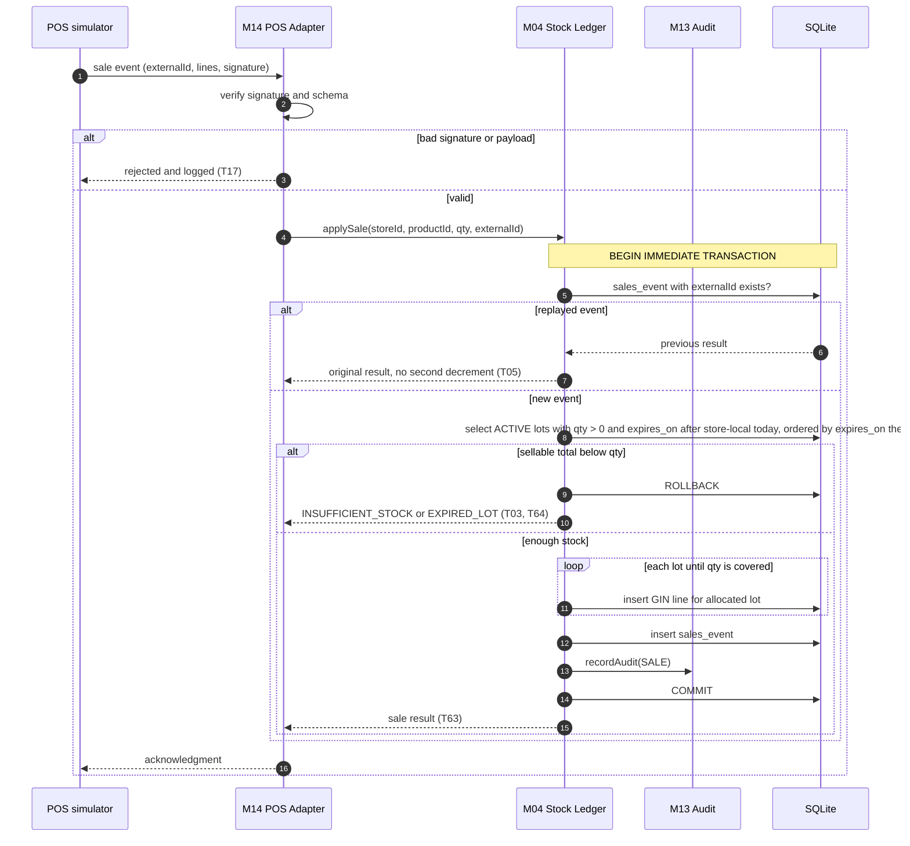

### UC-03 Manual correction with manager approval (F6, F8, T06, T07, T29, T31)

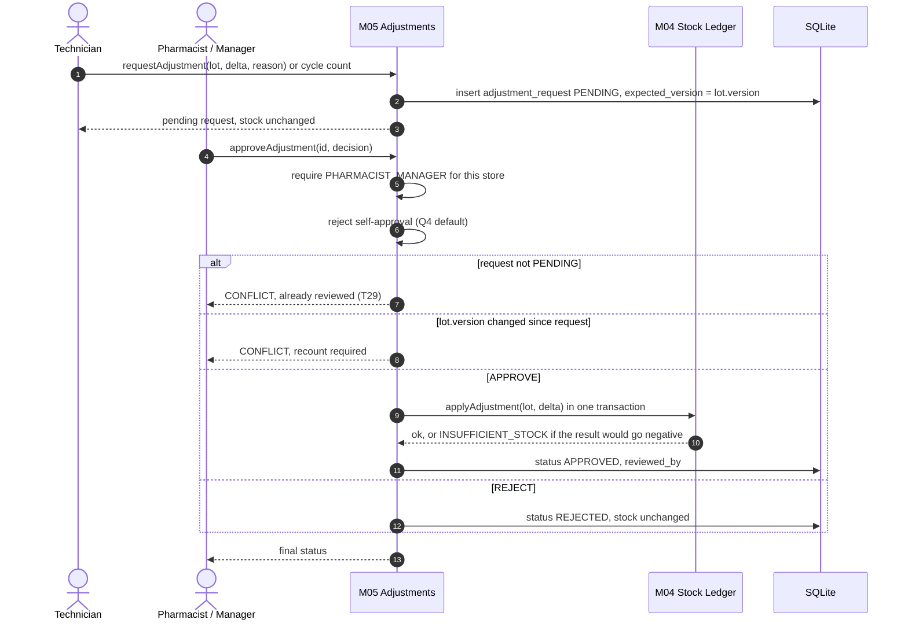

### UC-05 and UC-08 Reorder suggestion and forecast review (F13, F16, F17, F18, T10, T37, T41)

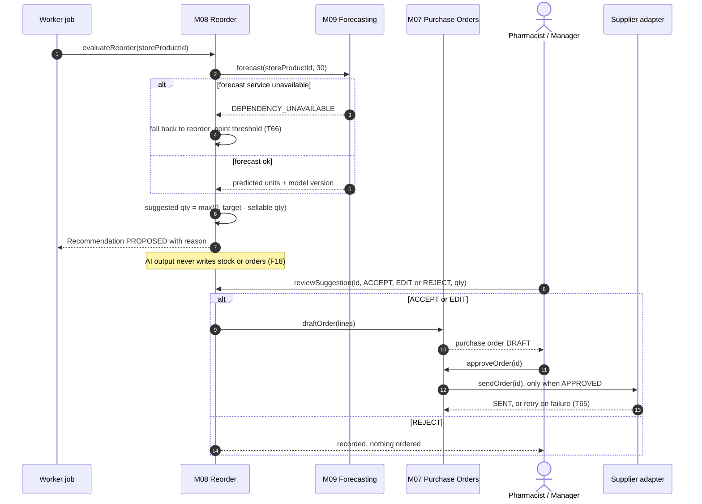

### UC-06 and UC-07 Public search and nearest pharmacy (F19 to F22, T12, T13, T43 to T46)

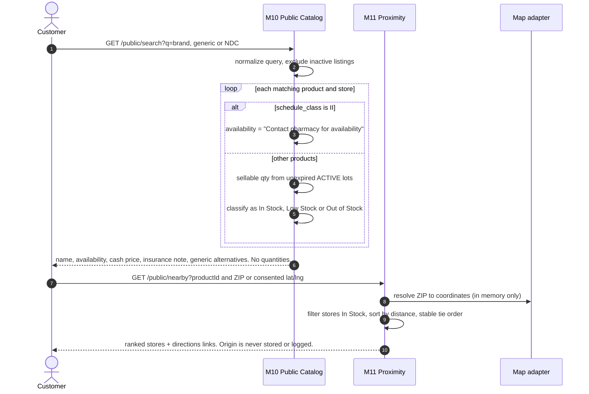

### Daily expiration job (F9, F10, T15, T32, T33)

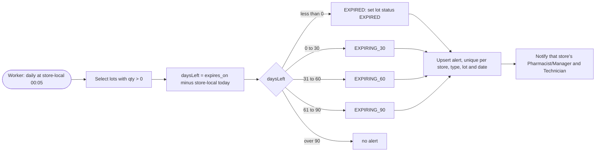

## 7. State machines

These diagrams implement DDS §7.1. A transition that isn't drawn is rejected with `CONFLICT`.

### Adjustment request

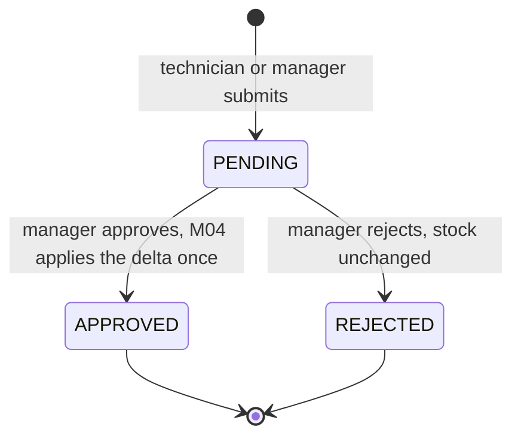

### Purchase order

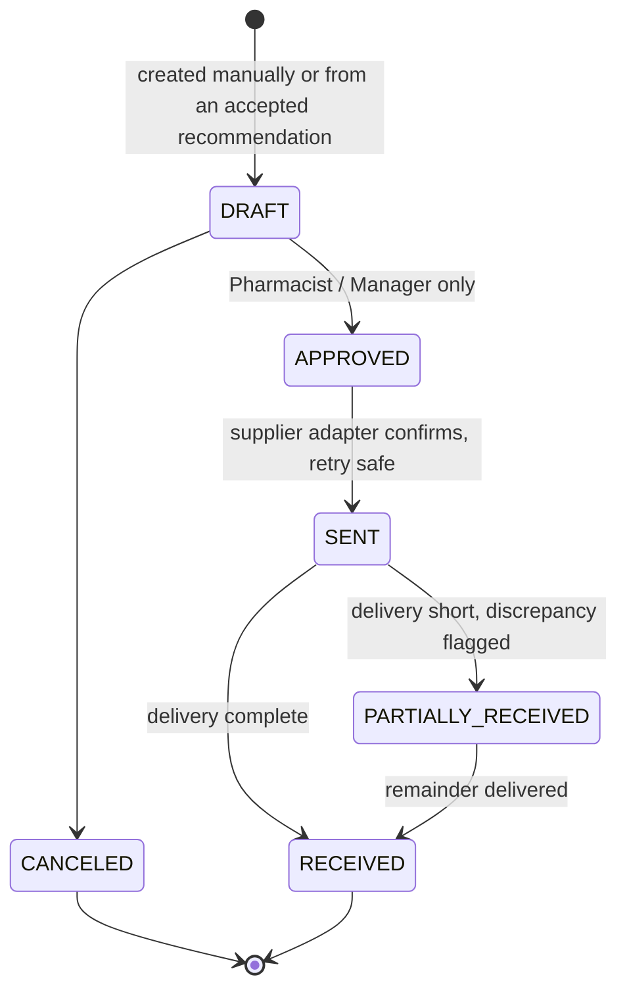

### Recommendation (AI advisory output)

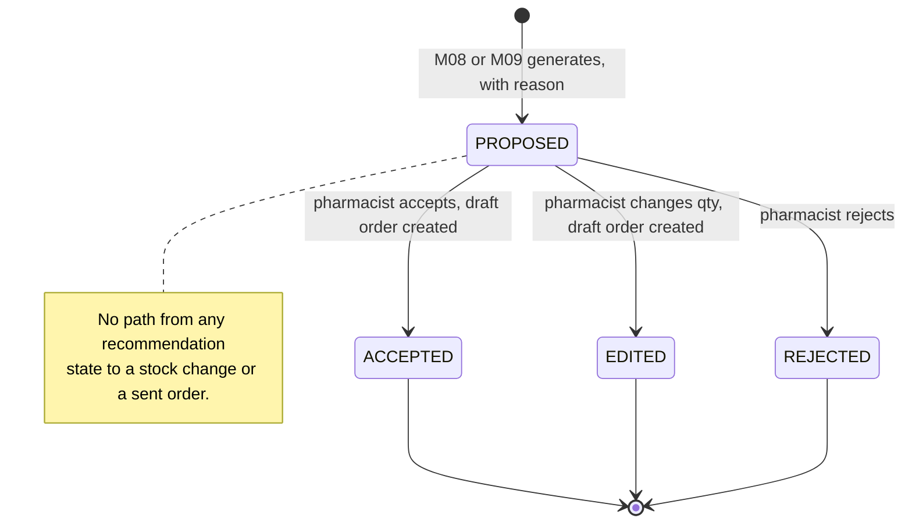

### Lot

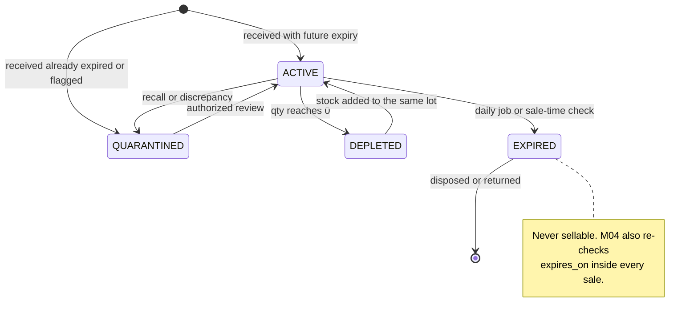

## API surface

All paths are prefixed with `/api/v1` (DDS §8). Responses use the `{ data, requestId }` / `{ error, requestId }` envelope. ✅ marks endpoints that are implemented; the rest return `501 NOT_IMPLEMENTED` until their iteration.

| Method | Path | Owner | Auth | Notes |
|---|---|---|---|---|
| GET | `/health` | core | public | Liveness + DB check |
| POST | `/auth/login` | M01 | public | ✅ email + password + one-time code in one request; 5 failures lock the account |
| POST | `/auth/logout` | M01 | staff | ✅ Revokes the session |
| GET | `/auth/me` | M01 | staff | ✅ Current actor + role assignments |
| GET | `/stores` | M01 | staff | ✅ Caller's stores (all stores for admins) |
| GET | `/admin/users` | M01 | admin | ✅ List staff accounts |
| POST | `/admin/users` | M01 | admin | ✅ Create staff account, assign roles; returns TOTP setup once |
| POST | `/admin/users/:id/unlock` | M01 | admin | ✅ Unlock a locked account |
| GET | `/products` | M02 | staff | ✅ Search brand/generic/NDC, `includeInactive`, cursor pagination |
| GET | `/products/:id` | M02 | staff | ✅ One product, including inactive |
| POST | `/products` | M02 | manager | ✅ Create product (duplicate NDC → 409) |
| PATCH | `/products/:id` | M02 | manager | ✅ Update, deactivate (`active: false`) or reactivate |
| POST | `/stores/:storeId/receipts` | M03 | tech/manager | `Idempotency-Key` header |
| GET | `/stores/:storeId/inventory` | M04 | tech/manager | Per-lot stock, filters |
| POST | `/stores/:storeId/sales-events` | M14 | POS service | Signed, idempotent by external ID |
| POST | `/adjustments` | M05 | tech/manager | Creates PENDING |
| POST | `/adjustments/:id/approve` | M05 | manager | `{ decision, expectedVersion }` |
| POST | `/stores/:storeId/cycle-counts` | M05 | tech/manager | Flags differences |
| GET | `/stores/:storeId/expiring?days=30` | M06 | tech/manager | days ∈ {30, 60, 90} |
| POST | `/stores/:storeId/disposals` | M06 | tech/manager | Records dollar loss |
| GET/POST | `/suppliers` | M07 | manager | Supplier records |
| POST | `/orders` | M07 | tech/manager | Creates DRAFT |
| POST | `/orders/:id/approve` | M07 | manager | |
| POST | `/orders/:id/send` | M07 | manager | Only from APPROVED |
| POST | `/orders/:id/receipts` | M07 | tech/manager | Partial or full delivery |
| GET | `/forecast/:storeProductId?days=30` | M09 | staff | Advisory only |
| GET | `/stores/:storeId/recommendations` | M08 | staff | |
| POST | `/recommendations/:id/review` | M08 | manager | accept / edit / reject |
| GET | `/stores/:storeId/dashboard` | M12 | staff | Low stock, expiring, pending orders, AI alerts |
| GET | `/stores/:storeId/reports?type=&from=&to=` | M13 | manager | CSV export |
| GET | `/audit` | M13 | admin | ✅ Newest first; filter by store, entity, date (Q7 proposal) |
| GET | `/public/search?q=` | M10 | public | No quantities, Schedule II masked |
| GET | `/public/nearby?productId=&zip=` | M11 | public | Location never stored |
| POST | `/public/customers` | M15 | public | Optional registration |
| POST | `/public/subscriptions` | M15 | customer | Back-in-stock notice |
| DELETE | `/public/subscriptions/:id` | M15 | customer | Unsubscribe |
| POST | `/chat` | M16 | staff | Read-only answers |

Rows not listed in DDS §8 (logout, me, stores, admin users, unlock, product by id, cycle counts, disposals, suppliers, send, order receipts, recommendations list, audit, customer endpoints, chat) are proposed additions. Each one is needed by a requirement the DDS assigns to the owning module.

## 9. Security and privacy boundaries

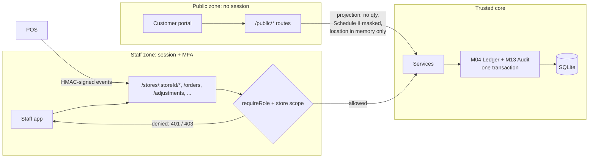

**Permission matrix** (DDS §9.1). The server enforces it on every request.

| Operation | Technician | Pharmacist / Manager | System Admin | Customer |
|---|---|---|---|---|
| Receive stock | ✅ | ✅ | as assigned | ❌ |
| Approve adjustments | ❌ | ✅ | ❌ by default | ❌ |
| Approve purchase orders | ❌ | ✅ | ❌ by default | ❌ |
| View detailed lots | ✅ | ✅ | as assigned | ❌ |
| Public search | ✅ | ✅ | ✅ | ✅ |
| Manage users / stores | ❌ | ❌ | ✅ | ❌ |
| Review forecasts | read | decide | as assigned | ❌ |

**Implementation notes**
- Passwords are hashed with `scrypt` (Node `crypto`) and a per-user salt. MFA uses TOTP one-time codes, with a stub provider in tests.
- Session tokens are random. Only their hash is stored.
- The DDS §4.2 error envelope returns no stack traces. `INTERNAL_ERROR` carries the correlation `requestId`.
- Request logs drop `lat`, `lng` and `zip` query parameters (F21, T57).
- CSV exports escape cells that start with `=`, `+`, `-` or `@` (T49).
- Encryption at rest (N4) is out of scope for the SQLite prototype. It's documented as a gap with options: SQLCipher or an encrypted volume.

## 10. Integration increments

Implementation and testing grow outward from the inventory kernel (Test Plan §3.2). The audit writer from M13 ships in I1, because the kernel commits every stock delta together with its audit event (proposed answer to Q12).

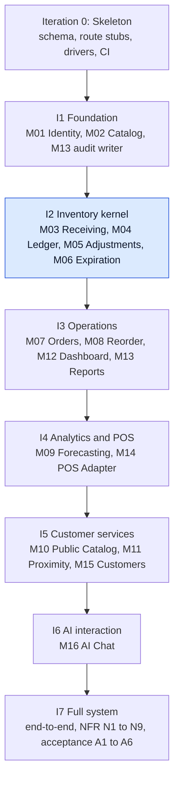
